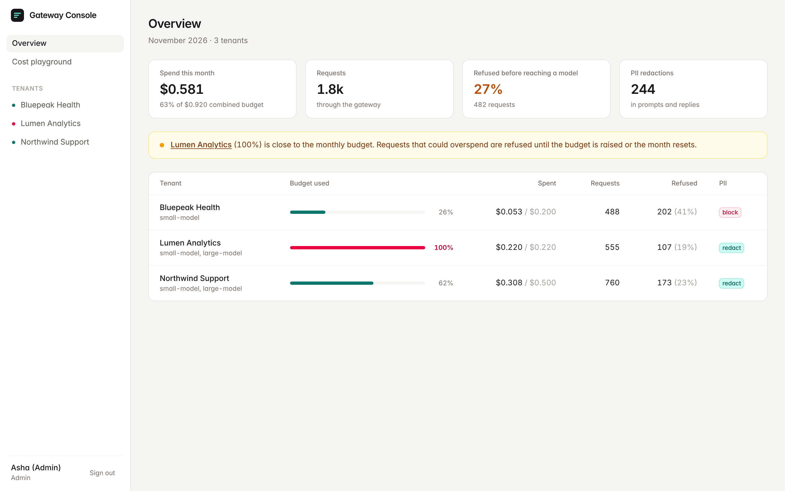
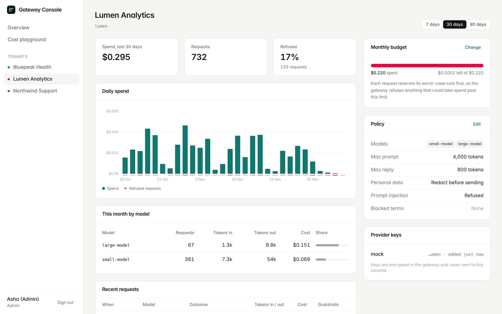
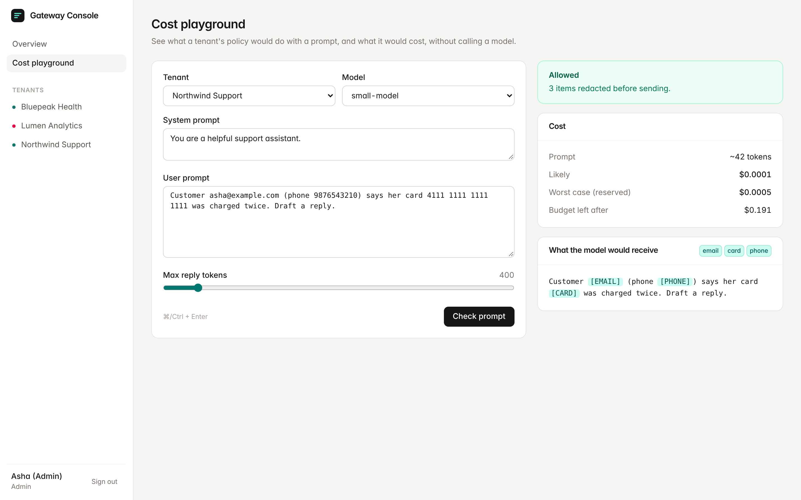
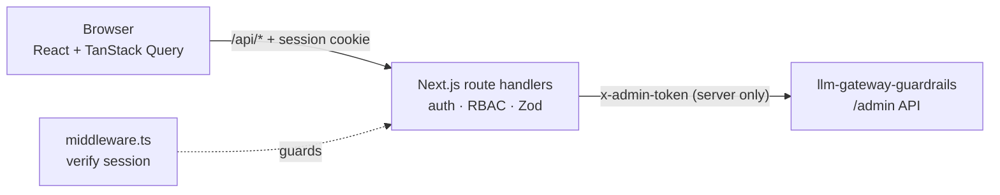

# gateway-dashboard

Admin console for [llm-gateway-guardrails](https://github.com/prakash6018/llm-gateway-guardrails): see what every tenant is spending against its budget, what the guardrails refused and why, change budgets and policies, and check what a prompt would cost before anyone sends it.

**Next.js 15 (App Router) · React 19 · TypeScript · Tailwind CSS v4 · TanStack Query · Zod**



| Tenant detail | Cost playground |
|---|---|
|  |  |

## Features

- **Overview**: month-to-date spend vs budget per tenant, refusal rate, PII redactions, and a callout for tenants at their limit.
- **Tenant detail**: daily spend chart (7/30/90 days, hand-built SVG with hover details), spend by model, recent requests with outcome and which guardrail fired, provider key hints.
- **Policy and budget editing**: allowed models, token limits, PII mode, injection blocking, blocked terms. Validated with the same Zod schema in the browser and on the server.
- **Cost playground**: pick a tenant and model, write a prompt, and see the policy verdict, the redacted text the model would receive, the likely and worst-case cost, and whether it fits the remaining budget. No model is called.
- **Roles**: `admin` can change budgets and policies; `viewer` can see everything and run cost checks. The UI hides controls a role can't use, and **the server enforces it**: a viewer's `PATCH` gets a 403 whatever the browser does.

## How it's put together



- **The admin token never reaches the browser.** Client code only calls this app's `/api/*` routes; those check the session and role, validate the body, then call the gateway with the token from server-side env.
- **Sessions** are HMAC-SHA256 signed cookies (`HttpOnly`, `SameSite=Lax`, `Secure` in production, 8-hour expiry) using Web Crypto, so the same code verifies them in edge middleware and in route handlers. Editing the role inside the cookie breaks the signature.
- **Permissions depend on what a request changes**: a patch touching `policy` needs `policy:edit`, one touching the budget needs `budget:edit` (`lib/rbac.ts`).
- **Data fetching**: TanStack Query with 30-second background refresh; mutations invalidate the tenant list and detail so meters update after a save.
- **Demo sign-in** (`DEMO_LOGIN=on`) lets you choose Admin or Viewer. For real use, replace `app/api/session/route.ts` with an OIDC callback (Auth0, Microsoft Entra ID) that maps a group claim to a role and calls `signSession`.

## Run it

You need the gateway running with its admin API and demo data:

```bash
cd ../llm-gateway-guardrails
export GATEWAY_MASTER_KEY=$(node -e "console.log(require('crypto').randomBytes(32).toString('base64'))")
export GATEWAY_ADMIN_TOKEN=dev-admin-token
node examples/seed-demo.ts demo.db               # 3 fictional tenants, 30 days of traffic
node src/main.ts --db demo.db --port 8787
```

Then the dashboard:

```bash
cd ../gateway-dashboard
cp .env.example .env.local     # set GATEWAY_ADMIN_TOKEN=dev-admin-token and a SESSION_SECRET
npm install
npm run dev                    # http://localhost:3000
```

```bash
npm test        # sessions (tampering, expiry), RBAC, schemas, formatting, route authorization
npm run build   # production build + type check
```

## Project layout

```
app/                      pages (overview, tenants/[id], playground, login) and API route handlers
app/api/tenants/...       proxies to the gateway admin API after auth, RBAC and validation
middleware.ts             redirects to /login or returns 401 without a valid session
components/               Shell, Overview, TenantView, SpendChart, EventsTable, PolicyPanel, Playground
lib/session.ts            signed session tokens (Web Crypto)
lib/rbac.ts               roles and permissions
lib/schemas.ts            Zod schemas shared by forms and API routes
lib/server.ts             server-only auth helpers and gateway proxy
lib/api.ts                typed client + TanStack Query hooks
```

## License

MIT
